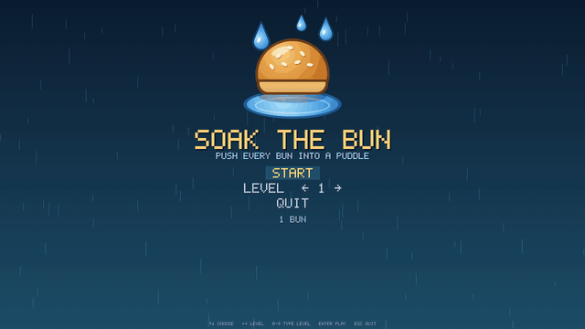

# Soak the Bun



A block-pushing puzzle game in the spirit of the original Sokoban, written in
C++17 with SDL2. You are a little water drop; push every hamburger bun into a
puddle until they are all soaked.

Every level is **generated procedurally** and gets harder as you go. All the
art (tiles, buns, the hero, the app icon) and the sound effects are produced by
code, so the game ships with no asset files.

A 720p version of the intro is in [docs/intro.mp4](docs/intro.mp4).

## How to play

| Key | Action |
| --- | --- |
| Arrow keys | Walk / push a bun (hold to keep walking) |
| U, Z or Backspace | Undo (hold to undo repeatedly) |
| R | Restart the level |
| M | Mute / unmute |
| Esc | Back to the menu |
| F11 or Alt+Enter | Toggle fullscreen |

A bun can only be pushed, never pulled, and only one at a time, so it is easy
to wedge one into a corner. Undo is your friend.

### Level menu

The menu lets you choose which level to start from:

* **Up / Down** select *Start*, *Level* or *Quit*.
* **Left / Right** change the level (Page Up / Page Down jump by 10, Home goes
  to level 1, End goes to the level after your best).
* **Digits** type a level number directly.
* **Enter** starts playing.

The level you last played is saved and offered as the default the next time
you launch the game. When you finish a level, the default moves on to the next
one. Progress is stored in `progress.ini` in the per-user folder SDL picks:

* Windows: `%APPDATA%\SoakTheBun\SoakTheBun\`
* Linux: `~/.local/share/SoakTheBun/SoakTheBun/`
* macOS: `~/Library/Application Support/SoakTheBun/SoakTheBun/`

## Procedural levels

Levels 1 to 999 are generated on the fly (`src/core/generator.cpp`):

1. **Room:** an open rectangle gets random wall shapes stamped into it. Then
   the generator keeps the largest connected area, fills dead ends and breaks
   up big open spaces.
2. **Goals:** puddles are placed and every bun is put on one, which is the
   solved position.
3. **Reverse search:** a breadth-first search runs *backwards* from the solved
   position using pulls (the reverse of a push). Every position it reaches is
   therefore solvable, and the search depth is the exact minimum number of
   pushes needed.
4. **Selection:** the most demanding position wins. That means the longest
   solution with the most changes of bun or direction, preferring starts where
   no bun is already in a puddle. Several rooms are tried per level and the
   best one is kept.

Difficulty rises with the level number. Each band adds a bun, and rooms, search
budget and the number of candidate rooms all grow:

| Levels | Buns |
| --- | --- |
| 1 | 1 |
| 2-3 | 2 |
| 4-8 | 3 |
| 9-17 | 4 |
| 18-35 | 5 |
| 36+ | 6 |

Solution lengths climb from 4 pushes on level 1 to roughly 30-60 pushes from
the mid-teens onwards. Past about level 40 the difficulty levels off, because
six buns is the most the search can handle quickly.

Generation is deterministic: level *N* is the same puzzle on every machine,
compiler and OS, using its own seeded PRNG with no `std::` distributions.
It runs on a background thread, and the next level is prepared while you play
the current one. The finish screen shows the minimum number of pushes, so you
can try for a perfect solve.

## Building

You need CMake 3.16+, a C++17 compiler and SDL2 (2.0.10 or newer). If CMake
cannot find SDL2, it downloads and builds it automatically. Turn that off with
`-DSOAK_FETCH_SDL=OFF`.

**Windows (Visual Studio + vcpkg):**

```sh
cmake -S . -B build -DCMAKE_TOOLCHAIN_FILE=%VCPKG_ROOT%/scripts/buildsystems/vcpkg.cmake
cmake --build build --config Release
build\Release\soakthebun.exe
```

`vcpkg.json` makes vcpkg install SDL2 automatically. `SDL2.dll` is copied next
to the executable, and the procedurally drawn icon is embedded in the `.exe`.

**Linux:**

```sh
sudo apt install build-essential cmake libsdl2-dev   # or your distro's equivalent
cmake -S . -B build -DCMAKE_BUILD_TYPE=Release
cmake --build build -j
./build/soakthebun
```

**macOS:**

```sh
brew install cmake sdl2
cmake -S . -B build -DCMAKE_BUILD_TYPE=Release
cmake --build build -j
./build/soakthebun
```

## Tests

`soak_tests` generates levels and checks each one: it must be well formed,
generated deterministically, and solvable. It also checks, with an independent
forward solver, that the generator's minimum push count is exactly right. The
solver's move-by-move solution is then replayed through the game's board to
confirm it really solves the level in that many pushes.

```sh
ctest --test-dir build -C Release          # levels 1-40
build/Release/soak_tests 80 1 --print      # levels 1-80, printing each as text
```

## Command-line options

```
--level N              preselect level N in the menu
--size WxH             window size (default 1024x768)
--screenshot FILE.bmp  render one frame to a file and exit (does not touch the save)
--scene menu|game|won|next   what to render with --screenshot
--moves UDLR...        moves to play before taking the screenshot
--record FILE|-        play the scripted intro, writing raw RGB24 frames ("-" = stdout)
--fps N                frame rate for --record (default 30)
```

### Regenerating the intro video

`tools/make_intro.sh` plays the scripted intro in an offscreen window. It
solves levels 1, 2 and 12 with the optimal solver, using the normal key
handling. The frames are piped into ffmpeg, which writes `docs/intro.mp4`
(1280x720, 30 fps) and `docs/intro.gif` (640x360, 15 fps). You need bash and
ffmpeg with libx264.

```sh
tools/make_intro.sh                    # uses build/Release/soakthebun or build/soakthebun
tools/make_intro.sh path/to/soakthebun
```

The recording is deterministic and never touches your save file.

## Layout

```
src/core/   level model, generator, solver (no SDL dependency)
src/gfx/    software rasterizer, procedural art, 5x7 pixel font (no SDL dependency)
src/app/    SDL2 game: scenes, input, rendering, audio, save file
tools/      icongen (app icon as a Windows .ico at build time), make_intro.sh (intro video)
tests/      generator verification
docs/       intro.gif / intro.mp4
```
